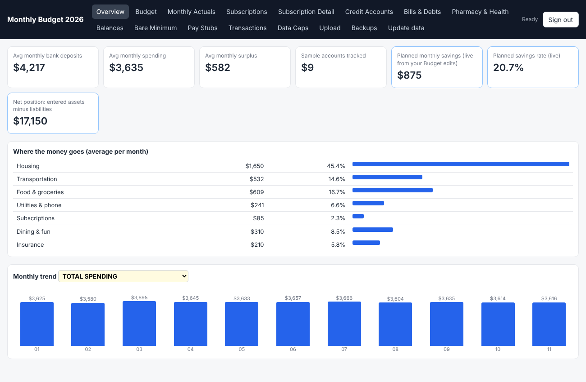

# Monthly Budget

> A private budget dashboard that turns your statements and pay stubs into numbers you can act on.

| | |
|---|---|
| **Category** | Home and life |
| **Status** | Working (demo mode in progress) |
| **Difficulty** | Deep end |
| **AI-assisted** | Yes |
| **Author** | [OtterLab](https://github.com/heyotterlab) |
| **License** | MIT when the code is published here |

<!-- The numbers in this screenshot are sample data. -->

## What it does

It's a dashboard on top of an Excel workbook that holds the same data. Pages cover the overview, budget, monthly actuals, subscriptions, credit accounts, bills and debts, balances and transactions. Yellow cells are editable and save automatically. New PDF statements are read in your browser and wait in a review queue until you approve them.

## Why I built it

To see where the money goes, work out why saving was hard, and have new bills and pay stubs update the numbers on their own.

## Built with

- Front end: one HTML file with plain JavaScript (pdf.js for PDFs, SheetJS for the workbook)
- Back end: a Python 3.12 Lambda function (256 MB) behind an API Gateway HTTP API, in AWS us-east-2
- Storage: a private, versioned, encrypted S3 bucket
- Sign-in: Cognito with multi-factor authentication
- Python scripts that parse statements and build the workbook

## How to try it

Not yet, sorry. It's locked to a private account and the repo is private. The scripts also use hardcoded local paths. I'm working on a sample workbook and a demo mode that skips sign-in, so you can run it yourself.

## Time and cost

About 5 days at 3 to 4 hours a day. The cost is about $0: Lambda and S3 were under a cent for November, and API Gateway and Cognito were $0.

## What I learned

- Keep the workbook as the master, and merge edits in without overwriting what you typed.
- Reading PDFs in the browser keeps statements off the server until you approve them.
- The page matched the workbook's totals to the cent in local and live AWS tests.
- Some scripts still contain personal merchant names, so I'm anonymizing the data before sharing the code.

## What I'd love help with

Ideas for a good demo mode, and for making the sample data feel realistic without being anyone's real data.

## Safe to share check

- [X] No passwords, API keys, tokens, `.env` contents or private keys (including screenshots)
- [X] No home public IP, personal data or private addresses
- [X] I wrote this or have the right to share it, and I've credited others
- [X] OtterLab may show this project, with credit to me, in the repo, Discord, website and social posts
