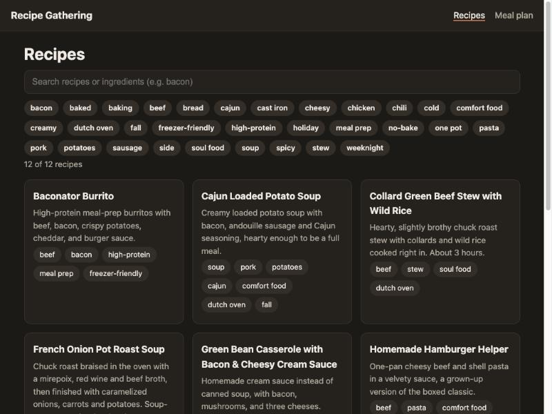

# Recipe Gathering

> A searchable home for the recipes you find online, with a weekly meal plan and shopping list.

| | |
|---|---|
| **Category** | Vibe coding |
| **Status** | Working (12 recipes so far, more added as I cook) |
| **Difficulty** | Tinkerer |
| **AI-assisted** | Yes |
| **Author** | [OtterLab](https://github.com/heyotterlab) |
| **License** | MIT when the code is published here |

## What it does

It keeps recipes in one place instead of scattered across bookmarks and saved videos. You can search by recipe or ingredient, filter by tags like `one pot` or `freezer-friendly`, build a weekly meal plan with a shopping list, and download any recipe as a Word file.

## Why I built it

Good recipes kept getting lost. Now there's one page I can actually find them on.

## Built with

- Plain HTML, CSS and JavaScript
- A small Node build script, plus the `docx` package for the Word downloads
- AWS in us-east-2: a private S3 bucket behind CloudFront, defined in one CloudFormation template
- The domain `recipes.otterlab.click`, registered through Route 53
- Every push to `main` redeploys automatically, and no AWS keys are stored in GitHub

## How to try it

Open the live site: <https://recipes.otterlab.click>. The code is in a private repo for now and is moving here soon.

## Time and cost

The first commit was on Nov 23 and most of the build happened that evening. Recipes have been added since. The domain is about $3 a year. Hosting should be pennies a month at this size (that's an estimate).

## What I learned

- GitHub's deploy tokens carry numeric IDs, so the AWS role only worked once the repo was written as `OWNER@ID/REPO@ID`.
- CloudFront certificates must be created in us-east-1, even when the site lives in us-east-2.
- CloudFront took 30+ minutes to attach the custom domain. Go make tea.
- Meal plan checkmarks are saved per browser, so they don't sync between devices.
- The site is public, so keep anything private out of the recipes.

## Safe to share check

- [X] No passwords, API keys, tokens, `.env` contents or private keys (including screenshots)
- [X] No home public IP, personal data or private addresses
- [X] I wrote this or have the right to share it, and I've credited others
- [X] OtterLab may show this project, with credit to me, in the repo, Discord, website and social posts
